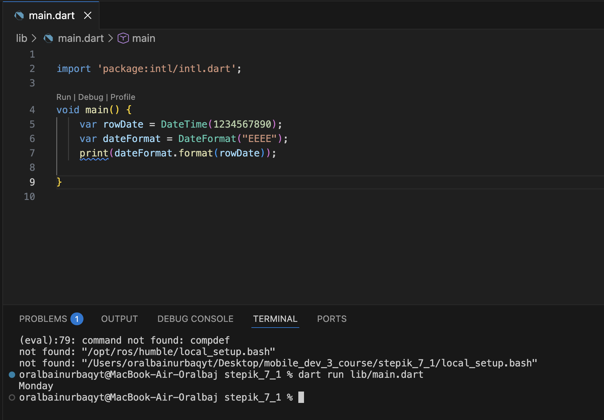

# Stepik 7.1 — Пакеты и зависимости

This is Task 7.1 from my Stepik Flutter course.

This task covers formatting dates using the `intl` package — creating a `DateTime` object and formatting it with `DateFormat` to display the full weekday name (e.g. "Monday").

## Code

```dart
import 'package:intl/intl.dart';

void main() {
  var rowDate = DateTime(1234567890);
  var dateFormat = DateFormat("EEEE");
  print(dateFormat.format(rowDate));
}
```

## Output

```
Monday
```

## Screenshot



## Key concept

The `intl` package's `DateFormat` class lets you format `DateTime` objects into human-readable strings using pattern letters — here `"EEEE"` produces the full name of the day of the week.

## Tech

- Flutter / Dart
- [`intl`](https://pub.dev/packages/intl) package
